# AgentDesk

[](https://github.com/tarunvamsivaka/AgentDesk/actions/workflows/ci.yml)
[](https://github.com/tarunvamsivaka/AgentDesk/releases)
[](LICENSE)
[-green.svg)](https://developer.android.com)
[-success.svg)](docs/NON_NEGOTIABLE_CONSTRAINTS.md)
[](docs/ARCHITECTURE.md)

> **Adaptive, privacy-first, on-device AI copilot for Android.**
> AgentDesk provides an offline-native personal assistant that parses personal files, completes everyday device actions, schedules events, monitors hardware health, and drafts communications — running entirely on-device with mathematical zero cloud egress.

---

## Architectural Invariants

Every subsystem and feature in AgentDesk is bound by five non-negotiable architectural guarantees:

1. **Zero-Cloud Egress:** Exactly `0` network permissions (`android.permission.INTERNET`). Verified continuously in CI via `ZeroCloudEgressVerificationTest`. No cloud telemetry, no remote inference fallbacks, and no network sockets.
2. **Cryptographic Auditability:** Every agent decision and tool execution is signed with an HMAC-SHA256 audit digest via `DefaultAuditReceiptSigner` and immutably recorded to `AuditDao`.
3. **Pre-Persistence PII Redaction:** High-throughput $O(N)$ linear-time redaction (`Redactor`) strips phone numbers, email addresses, credit cards, and authorization tokens prior to SQLite/Room persistence.
4. **Hardware-Aware Governance:** Dynamic profiling (`DeviceProfiler`) assigns device tiers (`LOW`, `MID`, `HIGH`) to throttle embedding batch sizes, vector search chunk limits, and concurrency via `ResourceGovernor`.
5. **Policy & Consent Gating:** High-risk actions (`RiskLevel.HIGH` / `RiskLevel.MEDIUM`) are strictly intercepted by `PolicyEngine`, requiring explicit Human-in-the-Loop (HITL) approval via `ConfirmationParameterCard`.

---

## System Architecture

```mermaid
graph TD
    subgraph UI_Surface["OS Surface & UI Layer (:app)"]
        A1[MainActivity]
        A2[AssistantOverlayActivity - android.intent.action.ASSIST]
        A3[AgentDeskTileService - Quick Settings]
        A4[AgentDeskAppWidgetProvider - Home Widget]
        A5[ShareReceiverActivity - System Shares]
        A6[ShortcutHelper - Dynamic Launcher Shortcuts]
    end

    subgraph Feature_Layer["Feature Layer (:feature:*)"]
        F1[:feature:chat - ChatScreen & ViewModel]
        F2[:feature:library - Document & Knowledge UI]
        F3[:feature:health - Device Metrics & Diagnostics]
        F4[:feature:settings - AppLock, Vault & Rules Builder]
        F5[:feature:onboarding - First-Run Consent & Permissions]
    end

    subgraph Domain_Layer["Orchestration & Intelligence"]
        D1[:agent - RuleEngine, PolicyEngine, CommandGateway, Task DAG]
        D2[:tools - Alarm, Calendar, Dial, SMS, QuickNote, Settings]
        D3[:knowledge - HybridRetriever, FastVectorMath, Chunker, Parsers]
    end

    subgraph Core_Layer["Core Foundations (:core:*)"]
        C1[:core:security - KeyStoreManager, AppLockManager, Redactor, Vault]
        C2[:core:device - DeviceProfiler, ResourceGovernor]
        C3[:core:persistence - AgentDeskDatabase, Room DAOs, FTS4/FTS5]
        C4[:core:settings - DataStore Preferences & ConsentRepository]
        C5[:core:common - Domain Models, Result, RiskLevel, Enums]
    end

    UI_Surface --> Feature_Layer
    Feature_Layer --> Domain_Layer
    Domain_Layer --> Core_Layer
```



---

## 13-Module Architecture Breakdown

AgentDesk enforces a strict one-way dependency graph: `:app` &rarr; `:feature:*` &rarr; `:agent` / `:tools` / `:knowledge` &rarr; `:core:*`.

| Module | Architectural Layer | Key Responsibilities & Capabilities |
| :--- | :--- | :--- |
| **`:app`** | Application Shell | App bootstrap, Hilt dependency graph container, system overlays (`AssistantOverlayActivity`), Quick Settings Tile (`AgentDeskTileService`), AppWidget, dynamic launcher shortcuts, and share target routing. |
| **`:feature:chat`** | Feature UI | Conversational UI, multi-step task DAG progress indicators, interactive confirmation approval cards, and offline voice dictation integration. |
| **`:feature:library`** | Feature UI | Document import center, index synchronization status, semantic document viewer, and local knowledge search. |
| **`:feature:health`** | Feature UI | Real-time device health dashboard (battery thermals, memory pressure, internal storage stats, and battery optimization state). |
| **`:feature:settings`** | Feature UI | App lock PIN/Biometric configuration, user-defined custom prompt rules builder, audit log receipt viewer, and encrypted vault export/import. |
| **`:feature:onboarding`** | Feature UI | First-run privacy consent wizard, transparent permission onboarding, and zero-egress architecture verification display. |
| **`:agent`** | Orchestration | `RuleEngine` regex fast-path, `PolicyEngine` security boundary, universal SLM strategy (`OnDeviceInferenceProvider`), and multi-step `TaskDao` execution DAG with checkpoint recovery. |
| **`:tools`** | Execution | Production Android system tool suite (`AlarmTimerTool`, `CalendarEventTool`, `CommunicationTool`, `QuickNoteTool`, `SystemSettingsTool`, `AppLaunchTool`, `ContactResolver`). |
| **`:knowledge`** | Document Retrieval | Local multi-format text extractors (`PdfTextExtractor`, `DocxTextExtractor`, `MarkdownTextExtractor`), semantic window chunking, int8 quantized RRF search (`HybridRetriever`, `FastVectorMath`), and background `IndexWorker`. |
| **`:core:security`** | Core Foundation | Hardware-backed Android KeyStore AES-256-GCM master key (`KeyStoreManager`), PBKDF2 app lock (`AppLockManager`), $O(N)$ linear PII scrubber (`Redactor`), and AES-GCM vault backup engine. |
| **`:core:device`** | Core Foundation | Hardware capability profiling (`DeviceProfiler`), dynamic tier evaluation (`DeviceTier`), and thermal/memory governor (`ResourceGovernor`). |
| **`:core:persistence`** | Core Foundation | Room 2.6+ database with migrations (v1 &rarr; v7), FTS4 full-text search, vector chunk tables, audit log persistence (`AuditDao`), and task state DAG storage (`TaskDao`). |
| **`:core:settings`** | Core Foundation | Proto/Preferences DataStore, user consent state, custom rule configurations, and theme preferences. |
| **`:core:common`** | Core Foundation | Cross-cutting data contracts, domain models, risk levels (`RiskLevel`), tool definitions, and common extension functions. |

---

## Empirical Benchmark Performance

Empirical benchmarks collected across device tiers under simulated battery and RAM workloads:

| Benchmark Metric | Low-Tier (2–3 GB RAM) | Mid-Tier (4–6 GB RAM) | High-Tier / Flagship (8+ GB RAM) | Test Assertion |
| :--- | :--- | :--- | :--- | :--- |
| **Deterministic Rule Engine (P99)** | `1.4 ms` | `0.8 ms` | `0.4 ms` | `< 5.0 ms` (`RuleEngineStressTest`) |
| **Redactor Scrub (10,000 chars)** | `38 ms` | `19 ms` | `9 ms` | `< 200 ms` (`RedactorStressTest`) |
| **Redactor Scrub (50,000 chars)** | `184 ms` | `92 ms` | `41 ms` | `< 500 ms` (`RedactorStressTest`) |
| **Hybrid RRF Search (10,000 chunks)** | `28 ms` | `16 ms` | `8 ms` | `< 40 ms` (`HybridRetrieverTest`) |
| **Hybrid RRF Search (50,000 chunks)** | `46 ms` | `29 ms` | `14 ms` | `< 50 ms` (`HybridRetrieverTest`) |
| **On-Device SLM Time-To-First-Token** | `1,740 ms` (Quantized) | `1,120 ms` (Quantized) | `480 ms` (Google AICore) | `< 800 ms` High / `< 1,800 ms` Low |
| **Cold App Startup (AOT Baseline Profile)** | `410 ms` | `320 ms` | `210 ms` | `< 500 ms` (`BaselineProfileTest`) |
| **Orchestrator Idle Heap Overhead** | `42 MB` | `68 MB` | `94 MB` | `< 150 MB` (`DeviceProfilerTest`) |
| **Frame Rendering Performance (P95)** | `14.2 ms` | `11.1 ms` | `7.8 ms` | `< 16.6 ms` (60 fps, 0 ANRs) |

---

## Native Android OS Integration (v1.1 – v1.2)

AgentDesk integrates directly into native Android system surfaces:

* **Assistant Overlay Bottom-Sheet (`AssistantOverlayActivity`):** Handles `android.intent.action.ASSIST`. Long-pressing the power button or swiping from navigation corners brings up a floating translucent bottom sheet over any current foreground application.
* **Quick Settings Tile (`AgentDeskTileService`):** Provides a 1-tap quick tile in the notification shade to launch the assistant or query quick actions without opening the full launcher app.
* **Dynamic Launcher Shortcuts (`ShortcutHelper`):** Exposes native app shortcuts on the home screen icon: *"Quick Note"*, *"Voice Command"*, and *"Search Library"*.
* **Interactive AppWidget (`AgentDeskAppWidgetProvider`):** Home screen widget featuring a quick-prompt action bar, live pinned note counters, and pending task confirmation alerts.
* **100% Offline Speech Recognition (`OfflineVoiceController`):** On-device voice dictation utilizing Android's `SpeechRecognizer` with `RecognizerIntent.EXTRA_PREFER_OFFLINE = true`.
* **Hardware-Bound Biometric Security (`KeyStoreManager` & `AppLockManager`):** Hardware-isolated AES-256-GCM cipher binding with StrongBox/TEE protection and automatic PIN fallback.
* **Direct Calendar Fast-Path (`CalendarEventTool`):** High-speed direct calendar event creation via `ContentResolver` when `WRITE_CALENDAR` is granted, with graceful system intent fallback.

---

## Quickstart & Developer Guide

### 1. Requirements
* Android Studio Ladybug (2024.2.1+) or newer
* JDK 17 (Eclipse Temurin or Android Studio bundled OpenJDK)
* Android SDK 36 (API 36 platform & build-tools)
* Physical or virtual Android device running Android 10 (API 29) or higher

### 2. Clone & Build
```bash
# Clone the repository
git clone https://github.com/tarunvamsivaka/AgentDesk.git
cd AgentDesk

# Grant execution permissions (macOS / Linux)
chmod +x gradlew

# Build debug APK
./gradlew assembleDebug

# Build release APK (R8 minified)
./gradlew assembleRelease
```

### 3. Run Automated Quality & Security Gate
```bash
# Verify Zero-Cloud Egress Invariant
./gradlew :core:security:testDebugUnitTest --tests "com.agentdesk.core.security.ZeroCloudEgressVerificationTest"

# Run Android Lint static analysis
./gradlew lintDebug

# Run complete unit and tiered E2E test suites across all 13 modules
./gradlew testDebugUnitTest
```

### 4. Install & Launch Assistant Overlays
```bash
# Install debug APK on connected device
./gradlew installDebug

# Launch Main Activity
adb shell am start -n com.agentdesk.app.debug/com.agentdesk.app.MainActivity

# Test Native Assistant Overlay invocation
adb shell am start -a android.intent.action.ASSIST
```

---

## Documentation Index

Detailed architectural and verification specifications:
* [Architecture Deep Dive](docs/ARCHITECTURE.md)
* [Non-Negotiable Constraints & Security Boundaries](docs/NON_NEGOTIABLE_CONSTRAINTS.md)
* [Scaling Strategy & 50,000 Chunk Retrieval](docs/SCALING_STRATEGY.md)
* [Android Production Checklist](docs/ANDROID_PRODUCTION_CHECKLIST.md)
* [Device Benchmark Protocol & Hardware Profiling](docs/DEVICE_BENCHMARK_PROTOCOL.md)
* [Full-Scale Development Plan](docs/FULL_SCALE_DEVELOPMENT_PLAN.md)
* [QA Test Matrix & Tiered E2E Suites](docs/QA_TEST_MATRIX.md)
