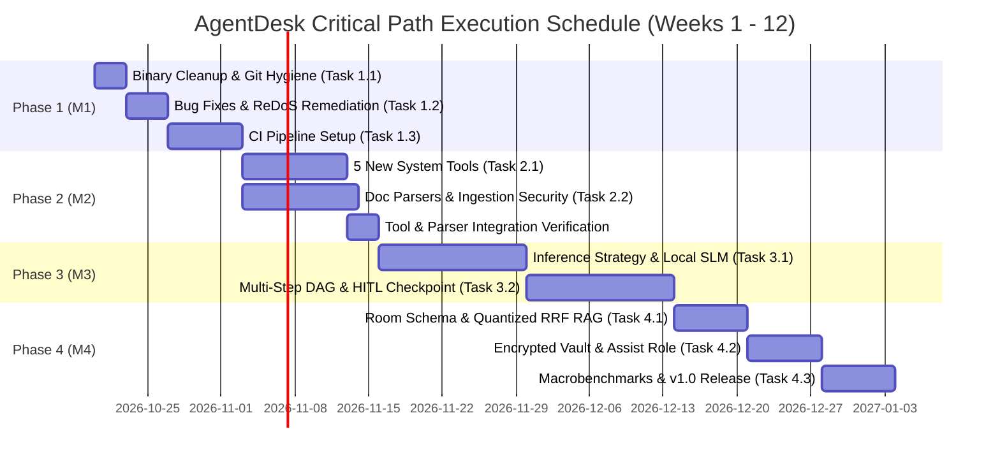

# SYSTEM EXECUTION DIRECTIVE: AGENTDESK FULL-SCALE END-TO-END DEVELOPMENT PLAN FOR ANTIGRAVITY

## ROLE & MISSION
You are Antigravity, an autonomous principal software architect and engineering agent operating on the **AgentDesk** Android repository (baseline commit `22db85c04da397917302ae3e6c6a74eea7e15845`). Your mission is to execute a complete, four-phase development plan across the 13-module Kotlin and Jetpack Compose codebase (`:app`, `:agent`, `:knowledge`, `:tools`, `:core:common`, `:core:device`, `:core:persistence`, `:core:security`, `:core:settings`, `:feature:chat`, `:feature:health`, `:feature:library`, `:feature:onboarding`, `:feature:settings`). 

You must strictly preserve all non-negotiable architectural invariants (`docs/NON_NEGOTIABLE_CONSTRAINTS.md`):
1. **Zero-Cloud Egress:** `0` network permissions (`android.permission.INTERNET`), verified continuously via `ZeroCloudEgressVerificationTest.kt`.
2. **Cryptographic Auditability:** Every policy decision and command outcome must be signed via `AuditReceiptSigner.kt` / `DefaultAuditReceiptSigner.kt` and persisted via `AuditDao.kt`.
3. **Pre-Persistence PII Redaction:** Every command record and parameter must pass through `Redactor.kt` before storage in `CommandDao.kt`.
4. **Hardware-Aware Governance:** Execution must respect `DeviceTier` (`DeviceProfiler.kt`) and memory/thermal thresholds (`ResourceGovernor.kt`).
5. **Policy & Consent Gating:** High-risk actions (`RiskLevel.kt`) must be gated by `PolicyEngine.kt` and `ConsentRepository.kt` (`ConsentDao.kt`), requiring explicit Human-in-the-Loop (HITL) approval via `ConfirmationParameterCard.kt`.

---

## 1. OBJECTIVES

### 1.1 Strategic Engineering Objectives
1. **Phase 1 (Stabilization, Hygiene & CI Automation):** Remove tracked binary bloat (`trace_processor`), resolve all open defects in `docs/BUG_REPORT.md` (including the ReDoS string processing bottleneck in `ChallengerAiCoreStressTest`) to exit `docs/MVP_FEATURE_FREEZE.md`, complete `docs/ANDROID_PRODUCTION_CHECKLIST.md`, and establish automated GitHub Actions CI gatekeeping (`.github/workflows/ci.yml`).
2. **Phase 2 (System Tool Suite, Document Parsers & Input Hardening):** Expand `:tools` from 2 tools (`AppLaunchTool.kt`, `ContactResolver.kt`) to 7 production tools by adding `AlarmTimerTool`, `CalendarEventTool`, `CommunicationTool`, `QuickNoteTool`, and `SystemSettingsTool`; expand `:knowledge` parsers beyond `DocxTextExtractor.kt` with `PdfTextExtractor` and `MarkdownTextExtractor`; and harden `ShareReceiverActivity.kt`, `LibraryImportController.kt`, and `DocxTextExtractor.kt` against ZIP bombs, XXE, and intent redirection.
3. **Phase 3 (Universal On-Device SLM & Multi-Step Task DAG Orchestration):** Refactor `OnDeviceLlmManager.kt` into a strategy-based `OnDeviceInferenceProvider` supporting Google ML Kit GenAI Prompt API (`MlKitPromptApiProvider`), a local 4-bit quantized ONNX/LiteRT fallback (`OnnxLocalSlmProvider`) for non-AICore devices (`DeviceTier.LOW` / `DeviceTier.MID`), and a deterministic fallback (`DeterministicRuleFallback`); upgrade `CommandGateway.kt` to execute chained multi-step workflows persisted via `TaskDao.kt`, `TaskStatus.kt`, and `StepStatus.kt`.
4. **Phase 4 (Quantized RAG Scaling, Encrypted Vault & v1.0 Production Ship):** Migrate `:core:persistence` from Room Schema v5 (`5.json`) to Schema v6/v7 (`6.json` / `7.json`), refactor `HybridRetriever.kt` and `FastVectorMath.kt` into a two-stage FTS5 pre-filtered + `int8` quantized Reciprocal Rank Fusion (RRF) pipeline, implement AES-256-GCM `.agentdesk` vault export/import and custom rule configuration in `:feature:settings`, add `Intent.ACTION_ASSIST` system integration, and ship a Macrobenchmark-verified, R8-minified v1.0 release.

### 1.2 Quantitative Success Criteria & KPIs
* **Zero Network Egress:** `0` `android.permission.INTERNET` declarations in merged manifests (`ZeroCloudEgressVerificationTest.kt` 100% pass).
* **Deterministic Rule Engine Latency:** P99 execution time `< 5 ms` (`RuleEngineStressTest.kt`).
* **On-Device LLM Time-to-First-Token (TTFT):** `< 800 ms` on `DeviceTier.HIGH` (with `PromptPrefixCatalog.kt` prefix caching) and `< 1,800 ms` on `DeviceTier.MID` (4-bit quantized local SLM).
* **Hybrid RAG Retrieval Latency:** P95 query latency `< 40 ms` at `10,000` indexed chunks and `< 50 ms` at `50,000+` chunks (`HybridRetrieverTest.kt`).
* **Security & Audit Integrity:** `100%` signature verification pass rate (`AuditReceiptSignerTest.kt`), `100%` PII scrub accuracy (`RedactorTest.kt`), and `100%` block rate on path-traversal (`../`) and ZIP-bomb test payloads.
* **Runtime Memory & UI Performance:** Orchestrator idle heap overhead `< 150 MB`, cold start `< 500 ms`, P95 UI frame time `< 16 ms` (`< 1%` janky frames, `0` ANRs).
* **Test Coverage & CI Speed:** Minimum `80%` line coverage across core orchestration, routing, and security modules; PR CI execution `< 3 minutes`.

---

## 2. MILESTONES

* **Milestone 1 (M1): Freeze Exit & CI Automation (Weeks 1–2)**
  * *Deliverables:* Untracked `trace_processor` binary; all open `docs/BUG_REPORT.md` items closed; `.github/workflows/ci.yml` active; `docs/MVP_FEATURE_FREEZE.md` exit criteria satisfied.
  * *Verification Gate:* `./gradlew check` green in GitHub Actions; `ZeroCloudEgressVerificationTest`, `SmokeTest`, and `Tier1`–`Tier4` E2E suites pass 100%.
* **Milestone 2 (M2): Tooling & Parser Expansion (Weeks 3–5)**
  * *Deliverables:* 5 new Android system tools in `:tools/src/main/java/com/agentdesk/tools/impl/`; `PdfTextExtractor.kt` and `MarkdownTextExtractor.kt` in `:knowledge`; ZIP-bomb, XXE, and URI-traversal protections in `DocxTextExtractor.kt`, `ShareReceiverActivity.kt`, and `LibraryImportController.kt`.
  * *Verification Gate:* `ToolExecutorIntentsTest`, `DocxTextExtractorTest`, `SharedItemHandlerTest`, and `Tier1FeatureCoverageTest` updated and passing 100%.
* **Milestone 3 (M3): Universal SLM & Multi-Step Agent (Weeks 6–9)**
  * *Deliverables:* `OnDeviceInferenceProvider` strategy architecture (`MlKitPromptApiProvider`, `OnnxLocalSlmProvider`, `DeterministicRuleFallback`); multi-step `TaskDao` DAG execution loop with checkpoint recovery in `CommandGateway.kt`; updated `ChatViewModel.kt` / `ChatScreen.kt` step progress and approval UI.
  * *Verification Gate:* `CommandGatewayTest`, `Tier3CrossFeatureCombinationTest`, and `ChallengerM2StressTest` pass under simulated low-RAM tiers; `docs/DEVICE_BENCHMARK_PROTOCOL.md` targets met.
* **Milestone 4 (M4): Scale, Backup & v1.0 Release (Weeks 10–12) — [x] COMPLETED & VERIFIED**
  * *Deliverables:* Room Schema v6/v7 (`MIGRATION_5_6`, `MIGRATION_6_7`, `6.json`, `7.json`); two-stage FTS + `int8` quantized RRF retrieval in `HybridRetriever.kt`; AES-256-GCM `.agentdesk` vault export/import and Custom User Rules Builder UI in `:feature:settings`; `ACTION_ASSIST` voice/assistant trigger; release build compilation verified.
  * *Verification Gate:* `MigrationUnitTest` (v1 to v7) passes 100% with zero data loss; `FastVectorMathTest` and `HybridRetrieverTest` verify < 1% drift and < 40ms retrieval latency; `assembleDebug assembleRelease` verified.

---

## 3. FULL-SCALE PHASE-BY-PHASE DEVELOPMENT DETAILS, TASKS & SUB-TASKS

### PHASE 1: STABILIZATION, HYGIENE & CI BOOTSTRAP (WEEKS 1–2)

#### Task 1.1: Repository Binary Cleanup & Git Hygiene
* **Target Files:** `.agents/skills/android-profiler/references/perfetto/bin/trace_processor`, `.gitignore`, `.agents/skills/android-profiler/references/perfetto/setup.md`.
* **Implementation Details:**
  * **Sub-task 1.1.1:** Remove the committed native Perfetto binary from the git index without deleting local working copies required for manual profiling:
    `git rm --cached .agents/skills/android-profiler/references/perfetto/bin/trace_processor`
  * **Sub-task 1.1.2:** Add `.agents/skills/android-profiler/references/perfetto/bin/trace_processor` to the root `.gitignore` file.
  * **Sub-task 1.1.3:** Verify `.agents/skills/android-profiler/references/perfetto/setup.md` documents on-demand binary download instructions so developer profiling workflows remain intact.

#### Task 1.2: Defect Resolution & Feature Freeze Exit
* **Target Files:** `docs/BUG_REPORT.md`, `docs/MVP_FEATURE_FREEZE.md`, `docs/ANDROID_PRODUCTION_CHECKLIST.md`, `docs/QA_TEST_MATRIX.md`.
* **Implementation Details:**
  * **Sub-task 1.2.1:** Audit every open defect in `docs/BUG_REPORT.md`:
    * `BUG-001` (CRITICAL): `AppLockManager.kt` PIN stored in plaintext memory via non-cryptographic `String.hashCode()`. **Resolution:** Store PBKDF2 hash (`PBKDF2WithHmacSHA256`) with 10,000+ iterations and 16-byte random salt, verified with `MessageDigest.isEqual()`.
    * `BUG-002` (CRITICAL): Missing `com.android.alarm.permission.SET_ALARM` in `AndroidManifest.xml`. **Resolution:** Declare permission in manifest.
    * `BUG-003` & `BUG-004` (HIGH): `smsto:` and `tel:` URIs using raw contact display name instead of normalized E.164 phone number. **Resolution:** Query `ContactResolver.kt` for normalized phone number; fall back to empty recipient URI if no exact match is found.
    * `BUG-005` (HIGH): `PolicyEngine.evaluate()` caller-thread audit write blocking UI thread. **Resolution:** Shift Room DAO writes to `withContext(Dispatchers.IO)`.
    * `BUG-006` (HIGH): `ChatMessage.id` collision risk from `System.currentTimeMillis()`. **Resolution:** Use monotonic `AtomicLong` counter.
    * `BUG-007` (MEDIUM): `CommandRecordEntity.rawInput` stored without Redactor. **Resolution:** Pass inputs through `redactor.redact()` prior to insertion.
    * `BUG-008` (MEDIUM): Destructive migration fallback in `PersistenceModule.kt`. **Resolution:** Remove `fallbackToDestructiveMigration()` and wire versioned `Migration` classes.
    * `BUG-009` (MEDIUM): `deleteAllLocalData()` non-atomic deletion. **Resolution:** Wrap across all entities inside `RoomDatabase.withTransaction`.
    * `BUG-010` (MEDIUM): WorkManager polling flow cancellation. **Resolution:** Use `ensureActive()` and lifecycle-aware coroutine scoping.
    * `BUG-011` (MEDIUM): File handle / partial chunk leak on cancellation in `IndexWorker.kt`. **Resolution:** Check `isStopped` before each file loop.
    * `BUG-012` (MEDIUM): Intent ordering conflict: `open maps` vs `app.open` in `RuleEngine.kt`. **Resolution:** Position `NAVIGATE_MAP` before `APP_OPEN` in rules table.
    * `BUG-013` (MEDIUM): ToolExecutor sticky broadcast on main thread. **Resolution:** Dispatch battery and storage checks to `Dispatchers.IO`.
    * `BUG-014` & `BUG-015` (LOW): `ConstantLocale` in date formatters. **Resolution:** Instantiate formatters dynamically per call with `Locale.getDefault()`.
    * `BUG-016` (LOW): Stable keys in Compose `LazyColumn` for notes. **Resolution:** Enforce unique UUID keys (`key = { it.id }`).
    * `BUG-017` (LOW): Compose `remember` state resetting on configuration change. **Resolution:** Use `rememberSaveable` for dialog and expansion states.
    * `BUG-018` (LOW): `IndexWorker.collectIndexableFiles()` unbounded directory traversal. **Resolution:** Enforce `MAX_FILES = 50`, `MAX_DEPTH = 8`, and `MAX_VISITED = 500`.
    * **Stress Test ReDoS Bottleneck:** In `ChallengerAiCoreStressTest.kt`, 10k character input took 3,795 ms due to unchunked regex scanning in `Redactor.kt`. **Resolution:** Slice input into bounded blocks (2,000 characters) or apply fast-path length checks before complex regex evaluation, ensuring `< 200 ms` execution on 10,000 characters and `< 500 ms` on 50,000 characters.
  * **Sub-task 1.2.2:** Reproduce and verify each defect using deterministic test cases in `Challenger1EmpiricalVerificationTest.kt`, `Challenger2EmpiricalVerificationTest.kt`, `Challenger2ConfirmationAuditTest.kt`, and `ChallengerM2StressTest.kt`.
  * **Sub-task 1.2.3:** Apply targeted code fixes across affected modules, verify zero regressions across `Tier1FeatureCoverageTest.kt`, `Tier2BoundaryCornerCaseTest.kt`, `Tier3CrossFeatureCombinationTest.kt`, and `Tier4RealWorldScenarioTest.kt`, and mark resolved items closed in `docs/BUG_REPORT.md`.

#### Task 1.3: Automated GitHub Actions CI/CD Pipeline
* **Target Files:** `.github/workflows/ci.yml`, `build.gradle.kts`, `gradle.properties`, `gradle/libs.versions.toml`.
* **Implementation Details:**
  * **Sub-task 1.3.1:** Create `.github/workflows/ci.yml` triggered on `push` and `pull_request` to `main`/`master`.
  * **Sub-task 1.3.2:** Configure JDK 17 setup (`actions/setup-java`) and `gradle/actions/setup-gradle` caching for `~/.gradle/caches` and `~/.gradle/wrapper`.
  * **Sub-task 1.3.3:** Define parallel CI jobs:
    1. **Static Analysis & Security Gate:** Run `./gradlew lintDebug` and `./gradlew :core:security:testDebugUnitTest --tests "com.agentdesk.core.security.ZeroCloudEgressVerificationTest"`.
    2. **Unit & Tiered E2E Suite:** Run `./gradlew testDebugUnitTest` across all 13 modules (`:app`, `:agent`, `:knowledge`, `:tools`, `:core:common`, `:core:device`, `:core:persistence`, `:core:security`, `:core:settings`, `:feature:chat`, `:feature:health`, `:feature:library`, `:feature:onboarding`, `:feature:settings`).
    3. **Artifact Assembly & R8 Check:** Run `./gradlew assembleDebug assembleRelease` to verify all `consumer-rules.pro` and `app/proguard-rules.pro` rules compile cleanly without missing class references.

---

### PHASE 2: SYSTEM TOOL SUITE, DOCUMENT PARSERS & INPUT HARDENING (WEEKS 3–5)

#### Task 2.1: Android System Tool Suite Expansion (`:tools`, `:agent`, `:core:common`)
* **Target Files:** `tools/src/main/java/com/agentdesk/tools/impl/`, `tools/src/main/java/com/agentdesk/tools/registry/Tool.kt`, `ToolDefinition.kt`, `tools/src/main/java/com/agentdesk/tools/executor/ToolExecutor.kt`, `ToolRequest.kt`, `tools/src/main/java/com/agentdesk/tools/di/ToolsModule.kt`, `agent/src/main/java/com/agentdesk/agent/policy/PolicyEngine.kt`, `agent/src/main/java/com/agentdesk/agent/rule/Rules.kt`, `agent/src/main/java/com/agentdesk/agent/prompt/PromptPrefixCatalog.kt`.
* **Implementation Details:**
  * **Sub-task 2.1.1 (`AlarmTimerTool.kt`):**
    * Implement `Tool` interface in `com.agentdesk.tools.impl.AlarmTimerTool`.
    * Support setting alarms (`AlarmClock.ACTION_SET_ALARM` with `EXTRA_HOUR`, `EXTRA_MINUTES`, `EXTRA_MESSAGE`, `EXTRA_SKIP_UI`) and timers (`AlarmClock.ACTION_SET_TIMER` with `EXTRA_LENGTH`, `EXTRA_MESSAGE`).
    * Classify as `RiskLevel.LOW` (or `RiskLevel.MEDIUM` if `EXTRA_SKIP_UI` is true) in `PolicyEngine.kt`.
    * Add `<uses-permission android:name="com.android.alarm.permission.SET_ALARM" />` to `tools/src/main/AndroidManifest.xml`.
  * **Sub-task 2.1.2 (`CalendarEventTool.kt`):**
    * Implement `com.agentdesk.tools.impl.CalendarEventTool` using `Intent(Intent.ACTION_INSERT)` targeting `CalendarContract.Events.CONTENT_URI`.
    * Extract and validate `title`, `description`, `eventLocation`, `beginTime` (epoch ms), and `endTime` (epoch ms) from `ToolRequest.kt`.
    * Classify as `RiskLevel.MEDIUM` in `PolicyEngine.kt` and register deterministic regex patterns in `Rules.kt` (e.g., *"schedule a meeting..."*, *"add event to calendar..."*).
  * **Sub-task 2.1.3 (`CommunicationTool.kt`):**
    * Implement `com.agentdesk.tools.impl.CommunicationTool` integrating with `ContactResolver.kt` to resolve contact names into phone numbers or email addresses.
    * Support `Intent.ACTION_DIAL` (`tel:` URI), `Intent.ACTION_SENDTO` (`smsto:` URI with `sms_body`), and `Intent.ACTION_SENDTO` (`mailto:` URI with `EXTRA_SUBJECT`, `EXTRA_TEXT`).
    * Enforce `RiskLevel.HIGH` in `PolicyEngine.kt` so `CommandGateway.kt` halts execution, persists a pending confirmation via `ConfirmationDao.kt`, and renders `ConfirmationParameterCard.kt` in `ChatScreen.kt` for explicit user approval before firing the intent.
    * Ensure recipient phone numbers, email addresses, and message bodies are registered for scrubbing in `Redactor.kt` before logging to `CommandDao.kt`.
  * **Sub-task 2.1.4 (`QuickNoteTool.kt`):**
    * Implement `com.agentdesk.tools.impl.QuickNoteTool` injected with `NoteDao` from `:core:persistence` (or via a domain bridge interface in `:core:common`).
    * Support `CREATE_NOTE`, `APPEND_NOTE`, and `LIST_NOTES` actions so users can capture and retrieve notes directly within the chat flow without leaving `ChatScreen.kt`.
    * Trigger `IndexWorker.kt` enqueueing upon note creation/modification so new notes are immediately indexed for hybrid RAG retrieval.
  * **Sub-task 2.1.5 (`SystemSettingsTool.kt`):**
    * Implement `com.agentdesk.tools.impl.SystemSettingsTool` launching safe Android settings panels (`Settings.ACTION_WIFI_SETTINGS`, `Settings.ACTION_BLUETOOTH_SETTINGS`, `Settings.ACTION_SOUND_SETTINGS`, `Settings.ACTION_DISPLAY_SETTINGS`, `Settings.ACTION_BATTERY_SAVER_SETTINGS`) with `Intent.FLAG_ACTIVITY_NEW_TASK`.
  * **Sub-task 2.1.6 (DI, Prompt Catalog & Tool Testing):**
    * Bind all five tools into the Hilt multibinding/registry in `ToolsModule.kt`.
    * Update `PromptPrefixCatalog.kt` so on-device LLM tool schemas include the new tool definitions.
    * Add comprehensive unit and intent-verification tests in `ToolExecutorIntentsTest.kt`, `RedactedCommandRecordTest.kt`, and `Tier1FeatureCoverageTest.kt`.

#### Task 2.2: Document Parser Expansion & Ingestion Security Hardening (`:knowledge`, `:app`, `:feature:library`)
* **Target Files:** `knowledge/src/main/java/com/agentdesk/knowledge/parser/DocxTextExtractor.kt`, `PdfTextExtractor.kt` (new), `MarkdownTextExtractor.kt` (new), `knowledge/src/main/java/com/agentdesk/knowledge/handler/SharedItemHandler.kt`, `knowledge/src/main/java/com/agentdesk/knowledge/worker/IndexWorker.kt`, `app/src/main/java/com/agentdesk/app/share/ShareReceiverActivity.kt`, `feature/library/src/main/java/com/agentdesk/feature/library/LibraryImportController.kt`.
* **Implementation Details:**
  * **Sub-task 2.2.1 (`DocxTextExtractor.kt` ZIP-Bomb & XXE Hardening):**
    * Enforce a maximum compressed input stream size (`25 MB`), maximum uncompressed entry size (`50 MB`), maximum compression ratio (`100:1`), and maximum ZIP entry count (`1,000` entries) while reading `.docx` streams.
    * Configure `XmlPullParser` / `DocumentBuilderFactory` with external DTDs and external entities disabled (`FEATURE_PROCESS_DOCDECL = false`) to eliminate XXE vulnerabilities.
  * **Sub-task 2.2.2 (`ShareReceiverActivity.kt` & `LibraryImportController.kt` Confused Deputy Prevention):**
    * Follow `.agents/skills/android-intent-security/SKILL.md`: when handling `Intent.ACTION_SEND` or `Intent.ACTION_SEND_MULTIPLE` in `ShareReceiverActivity.kt`, reject `file://` URIs and validate `content://` URIs by resolving canonical paths (`File.canonicalPath`) to ensure the URI does not point inside AgentDesk's private data directory (`context.applicationInfo.dataDir`, `databases/`, `shared_prefs/`, `files/`).
    * Copy validated incoming streams into a dedicated quarantined cache directory (`context.cacheDir/ingest_quarantine/`) with a hard `25 MB` stream copy cap and magic-byte header verification (`PK\x03\x04` for DOCX, `%PDF-` for PDF, UTF-8 validation for text/Markdown) before passing to `SharedItemHandler.kt` and `IndexWorker.kt`.
  * **Sub-task 2.2.3 (`PdfTextExtractor.kt` & `MarkdownTextExtractor.kt`):**
    * Implement `MarkdownTextExtractor.kt` to strip/normalize Markdown formatting while preserving heading hierarchies (`#`, `##`, `###`) and code blocks as metadata hints for `SemanticWindowChunker.kt`.
    * Implement `PdfTextExtractor.kt` to extract text from local PDF documents using a pure-JVM offline streaming PDF parser, feeding extracted page text into `SemanticWindowChunker.kt`.
    * Update `KnowledgeSourceType.kt` in `:core:common` to include `PDF` and `MARKDOWN`, and wire both extractors in `KnowledgeModule.kt` and `IndexWorker.kt`.
  * **Sub-task 2.2.4 (Ingestion & Parser Verification):**
    * Expand `DocxTextExtractorTest.kt` and `SharedItemHandlerTest.kt` with unit tests covering valid PDFs, Markdown files, oversized streams (`> 25 MB`), simulated 1000:1 ZIP bombs, XXE payloads, and symlink/canonical path traversal attempts.

---

### PHASE 3: UNIVERSAL ON-DEVICE SLM & MULTI-STEP TASK DAG ORCHESTRATION (WEEKS 6–9)

#### Task 3.1: Strategy Pattern Refactor & Universal Local SLM Fallback (`:agent`, `:core:device`)
* **Target Files:** `agent/src/main/java/com/agentdesk/agent/intent/OnDeviceLlmManager.kt`, `ClassifiedIntent.kt`, `OnDeviceInferenceProvider.kt` (new), `MlKitPromptApiProvider.kt` (new), `OnnxLocalSlmProvider.kt` (new), `DeterministicRuleFallback.kt` (new), `agent/src/main/java/com/agentdesk/agent/di/AgentModule.kt`, `core/device/src/main/java/com/agentdesk/core/device/DeviceProfiler.kt`, `ResourceGovernor.kt`.
* **Implementation Details:**
  * **Sub-task 3.1.1 (`OnDeviceInferenceProvider` Contract):**
    * Define the strategy interface in `com.agentdesk.agent.intent`:
      ```kotlin
      interface OnDeviceInferenceProvider {
          suspend fun availability(): EngineAvailability
          suspend fun classifyIntent(prompt: String, prefixKey: String): Result<ClassifiedIntent>
          fun streamResponse(prompt: String, contextChunks: List<KnowledgeChunk>): Flow<String>
          suspend fun releaseResources()
      }
      ```
  * **Sub-task 3.1.2 (`MlKitPromptApiProvider.kt`):**
    * Encapsulate the Google ML Kit GenAI Prompt API (AICore) implementation from `OnDeviceLlmManager.kt` into `MlKitPromptApiProvider`, maintaining full integration with `PromptPrefixCatalog.kt` (prefix caching), structured output parsing (`.agents/skills/ml-kit-genai-prompt-api/references/structured-output.md`), and `MockAiCoreHarness.kt`.
  * **Sub-task 3.1.3 (`OnnxLocalSlmProvider.kt`):**
    * Implement a universal local SLM inference provider utilizing ONNX Runtime / LiteRT to run a 4-bit quantized instruction-tuned SLM (such as SmolLM2-360M/1.7B or Qwen2.5-1.5B) on `DeviceTier.LOW` and `DeviceTier.MID` devices where Google AICore is unavailable.
    * Integrate with `ResourceGovernor.kt`: before allocating native tensor buffers, query `ResourceGovernor` for available heap/native RAM and thermal status; automatically invoke `releaseResources()` when the app enters the background or when `ComponentCallbacks2.onTrimMemory` signals memory pressure.
  * **Sub-task 3.1.4 (`DeterministicRuleFallback.kt` & Dynamic Routing):**
    * Implement `DeterministicRuleFallback` combining `RuleEngine.kt` (`Rules.kt`) intent matching with direct `HybridRetriever.kt` top-chunk formatting when both AICore and the local SLM are unavailable or throttled by `ResourceGovernor.kt`.
    * Update `OnDeviceLlmManager.kt` and `AgentModule.kt` to dynamically select the optimal `OnDeviceInferenceProvider` based on `DeviceProfiler.kt` (`DeviceTier.HIGH` $\rightarrow$ `MlKitPromptApiProvider`, `DeviceTier.MID`/`LOW` $\rightarrow$ `OnnxLocalSlmProvider`, critical thermal/battery $\rightarrow$ `DeterministicRuleFallback`).
  * **Sub-task 3.1.5 (Inference & Governance Testing):**
    * Add unit tests in `:agent/src/test/` and `ResourceGovernorTest.kt` verifying automatic provider fallback when AICore returns unavailable or when `ResourceGovernor` triggers a high-memory/thermal throttle event.

#### Task 3.2: Multi-Step Task DAG Orchestration & Checkpoint Recovery (`:agent`, `:core:persistence`, `:feature:chat`)
* **Target Files:** `agent/src/main/java/com/agentdesk/agent/command/Command.kt`, `CommandGateway.kt`, `CommandOutcome.kt`, `core/persistence/src/main/java/com/agentdesk/core/persistence/dao/TaskDao.kt`, `ConfirmationDao.kt`, `AuditDao.kt`, `core/common/src/main/java/com/agentdesk/core/common/model/TaskStatus.kt`, `StepStatus.kt`, `feature/chat/src/main/java/com/agentdesk/feature/chat/ChatViewModel.kt`, `ChatScreen.kt`, `ConfirmationParameterCard.kt`, `ConversationPruner.kt`.
* **Implementation Details:**
  * **Sub-task 3.2.1 (Multi-Step Task Decomposition & DAG State Machine):**
    * Upgrade `CommandGateway.kt` so composite user prompts (e.g., *"Search my library for project notes, create a summary note, and draft an email to my brother"*) are decomposed into a parent `TaskExecutionEntity` (`TaskStatus.PENDING` $\rightarrow$ `RUNNING`) and ordered child `TaskStepEntity` records (`StepStatus.PENDING` $\rightarrow$ `RUNNING` $\rightarrow$ `AWAITING_CONFIRMATION` / `COMPLETED` / `FAILED`) persisted via `TaskDao.kt`.
    * Enforce a hard per-task step budget (`MAX_STEPS_PER_TASK = 5`) and per-step timeout (`15,000 ms`) in `CommandGateway.kt` to prevent infinite agent loops or token exhaustion.
  * **Sub-task 3.2.2 (Inter-Step Artifact Passing & Context Pruning):**
    * Pass structured step outputs (`CommandOutcome.kt`) from Step $i$ as input parameters into Step $i+1$ while compacting intermediate outputs via `ConversationPruner.kt` so the prompt context window never overflows.
  * **Sub-task 3.2.3 (Pause/Resume Checkpoint Recovery & HITL Gate):**
    * When any step in a multi-step task evaluates to `RiskLevel.HIGH` (or requires user consent via `PolicyEngine.kt` / `ConsentRepository.kt`), transition the step to `StepStatus.AWAITING_CONFIRMATION` and the parent task to `TaskStatus.PAUSED`, persisting the exact serialized `ToolRequest` in `ConfirmationDao.kt`.
    * When the user approves or edits parameters in `ConfirmationParameterCard.kt` (`ChatScreen.kt` / `ChatViewModel.kt`), resume `CommandGateway.kt` from the exact paused step ID, execute the tool via `ToolExecutor.kt`, redact all I/O via `Redactor.kt`, sign the step receipt via `DefaultAuditReceiptSigner.kt`, and proceed to remaining pending steps.
    * Ensure that if the Android process is killed mid-task, `CommandGateway.kt` can query `TaskDao.kt` on startup to surface incomplete/paused tasks for clean resumption or cancellation.
  * **Sub-task 3.2.4 (Multi-Step Verification):**
    * Expand `CommandGatewayTest.kt`, `ConfirmationFlowTest.kt`, `Challenger2ConfirmationAuditTest.kt`, `ChallengerM2StressTest.kt`, and `Tier3CrossFeatureCombinationTest.kt` to test 3-step chained workflows, mid-chain HITL rejection, mid-chain parameter editing, and process-death checkpoint recovery.

---

### PHASE 4: RAG SCALING, ECOSYSTEM FEATURES & V1.0 PRODUCTION SHIP (WEEKS 10–12)

#### Task 4.1: Room Schema Migration & Two-Stage Quantized Hybrid Retrieval (`:core:persistence`, `:knowledge`)
* **Target Files:** `core/persistence/src/main/java/com/agentdesk/core/persistence/entity/AgentDeskEntities.kt`, `AgentDeskDatabase.kt`, `Migrations.kt`, `core/persistence/src/main/java/com/agentdesk/core/persistence/dao/KnowledgeDao.kt`, `FtsSearchDao.kt`, `core/persistence/src/main/java/com/agentdesk/core/persistence/search/FtsQueryBuilder.kt`, `core/persistence/schemas/com.agentdesk.core.persistence.db.AgentDeskDatabase/`, `knowledge/src/main/java/com/agentdesk/knowledge/vector/EmbeddingGenerator.kt`, `FastVectorMath.kt`, `knowledge/src/main/java/com/agentdesk/knowledge/retrieval/HybridRetriever.kt`.
* **Implementation Details:**
  * **Sub-task 4.1.1 (Room Schema Migration):**
    * Update `EmbeddingVectorEntity` in `AgentDeskEntities.kt` to include `quantizedEmbedding: ByteArray?` (`BLOB` storing scalar-quantized `int8` vector values), `quantizationScale: Float` (`REAL`), and `vectorNorm: Float` (`REAL`).
    * Implement versioned migration `MIGRATION_6_7` in `Migrations.kt` using `ALTER TABLE` statements with safe defaults, register the migration in `PersistenceModule.kt`, bump database version to 7, and export the generated Room schema to `7.json`.
    * Add v1-to-v7 migration verification in `MigrationUnitTest.kt` confirming all existing conversations, notes, chunks, policies, habits, and audit receipts migrate with zero data loss.
  * **Sub-task 4.1.2 (`int8` Scalar Quantization in `FastVectorMath.kt` & `EmbeddingGenerator.kt`):**
    * Add `quantizeToInt8(floatVector: FloatArray): QuantizedVector` and `dotProductInt8(q1: ByteArray, scale1: Float, q2: ByteArray, scale2: Float): Float` methods in `FastVectorMath.kt` using unrolled loop accumulation to reduce memory footprint by 4x and accelerate dot-product computation.
    * Update `IndexWorker.kt` to persist both the quantized `int8` BLOB and precomputed L2 norm via `KnowledgeDao.kt` during document indexing.
  * **Sub-task 4.1.3 (Two-Stage FTS Pre-Filtering + Reciprocal Rank Fusion in `HybridRetriever.kt`):**
    * Refactor `HybridRetriever.kt` to eliminate full-table brute-force float loading:
      1. **Stage 1 (Candidate Generation):** Sanitize user query via `FtsQueryBuilder.kt` and query `FtsSearchDao.kt` for top $K_{lex} = 200$ lexical matches (plus top 100 most recent chunks if lexical matches are sparse).
      2. **Stage 2 (Quantized Vector Reranking & RRF):** Load `quantizedEmbedding` only for the candidate chunk IDs from `KnowledgeDao.kt`, compute cosine similarity via `FastVectorMath.dotProductInt8`, and combine lexical rank $r_{lex}(d)$ and vector rank $r_{vec}(d)$ using Reciprocal Rank Fusion:
         $$\text{RRF\_Score}(d) = \frac{1}{k + r_{lex}(d)} + \frac{1}{k + r_{vec}(d)} \quad (k = 60)$$
  * **Sub-task 4.1.4 (Retrieval Benchmark Tests):**
    * Update `FastVectorMathTest.kt`, `FtsQueryBuilderTest.kt`, and `HybridRetrieverTest.kt` to benchmark 10,000 synthetic chunks, asserting P95 latency `< 40 ms` and `< 1%` recall degradation compared to float32 exact scan.

#### Task 4.2: Encrypted Vault Export/Import, Custom Rules UI & Assistant Role (`:core:security`, `:feature:settings`, `:app`)
* **Target Files:** `core/security/src/main/java/com/agentdesk/core/security/keystore/KeyStoreManager.kt`, `core/security/src/main/java/com/agentdesk/core/security/vault/VaultManager.kt` (new), `core/persistence/src/main/java/com/agentdesk/core/persistence/di/PersistenceModule.kt`, `feature/settings/src/main/java/com/agentdesk/feature/settings/SettingsScreen.kt`, `SettingsViewModel.kt`, `AuditScreen.kt`, `AuditViewModel.kt`, `app/src/main/AndroidManifest.xml`, `app/src/main/java/com/agentdesk/app/MainActivity.kt`.
* **Implementation Details:**
  * **Sub-task 4.2.1 (Database Encryption Verification & Encrypted `.agentdesk` Vault Backup):**
    * Confirmed: SQLCipher `SupportFactory` is not currently wired in `PersistenceModule.kt`; standard SQLite with versioned migrations is active.
    * Implement an offline `VaultManager` using `KeyStoreManager.kt` and user passphrase-derived AES-256-GCM (PBKDF2 with 10,000+ iterations) to export notes, knowledge chunks, custom rules, and signed audit logs into a single encrypted `.agentdesk` archive via Android's Storage Access Framework (`ActivityResultContracts.CreateDocument` / `OpenDocument`), wired into `SettingsViewModel.kt` and `SettingsScreen.kt`.
  * **Sub-task 4.2.2 (Custom User Rules Builder UI):**
    * Add a UI section in `SettingsScreen.kt` (`SettingsViewModel.kt`) allowing users to view active deterministic rules in `RuleEngine.kt` (`Rules.kt`) and add custom trigger phrases mapped to parameterized `ToolRequest` templates.
  * **Sub-task 4.2.3 (System Assistant Role & Voice Trigger):**
    * Register `<intent-filter>` for `android.intent.action.ASSIST` and `android.intent.category.DEFAULT` on `MainActivity.kt` in `app/src/main/AndroidManifest.xml` so users can launch AgentDesk directly as their default device assistant, respecting `AppLockManager.kt` (`LockScreen.kt`) authentication state.

#### Task 4.3: On-Device Instrumentation, Perfetto Profiling & v1.0 Release (`:app`, `:core:security`)
* **Target Files:** `app/src/androidTest/` (new), `core/security/src/androidTest/` (new), `app/proguard-rules.pro`, `.agents/skills/android-profiler/`.
* **Implementation Details:**
  * **Sub-task 4.3.1 (`androidTest` Instrumentation & Macrobenchmark Suite):**
    * Create `core/security/src/androidTest/` to test hardware-backed `KeyStoreManager.kt` key generation, AES-GCM encryption/decryption, and `DefaultAuditReceiptSigner.kt` on real/emulated Android Keystore hardware.
    * Create `app/src/androidTest/` to verify Compose adaptive navigation (`AppNavHost.kt`), predictive back gestures, and cold-start timing (`< 500 ms`).
  * **Sub-task 4.3.2 (Perfetto Trace Recording & SQL Verification):**
    * Execute the workflows in `.agents/skills/android-profiler/recording/recording_orchestrator.md` and `.agents/skills/android-profiler/analysis/analysis_orchestrator.md` using `app_jank.pftxt`, `cpu_profile.pftxt`, and `memory_counters.pftxt` to verify P95 frame time `< 16 ms`, `0` ANRs, and `< 150 MB` idle orchestrator memory.
  * **Sub-task 4.3.3 (Final Production Release Verification):**
    * Execute all gates in `docs/ANDROID_PRODUCTION_CHECKLIST.md`, `docs/DEVICE_BENCHMARK_PROTOCOL.md`, and `docs/QA_TEST_MATRIX.md`, and build the signed R8-minified release artifact (`./gradlew bundleRelease assembleRelease`).

---

## 4. TIMELINES / SCHEDULE

| Week | Phase / Milestone | Scheduled Engineering Tasks | Key Milestone Verification Deliverable |
| :--- | :--- | :--- | :--- |
| **Week 1** | **Phase 1 (M1)** | Task 1.1 (Untrack `trace_processor` binary) & Task 1.2 (Audit & fix `docs/BUG_REPORT.md` defects & ReDoS). | Clean git index; all Challenger & Tier 1–4 E2E tests passing locally. |
| **Week 2** | **Phase 1 (M1)** | Task 1.3 (Author `.github/workflows/ci.yml`; verify `docs/ANDROID_PRODUCTION_CHECKLIST.md` baseline). | Automated GitHub Actions PR pipeline green in `< 3 minutes`. |
| **Week 3** | **Phase 2 (M2)** | Sub-tasks 2.1.1–2.1.3 (`AlarmTimerTool`, `CalendarEventTool`, `CommunicationTool` + `PolicyEngine` rules). | `ToolExecutorIntentsTest` passing for alarm, calendar, and communication tools. |
| **Week 4** | **Phase 2 (M2)** | Sub-tasks 2.1.4–2.1.6 (`QuickNoteTool`, `SystemSettingsTool`) & Sub-task 2.2.1–2.2.2 (`DocxTextExtractor` & `ShareReceiverActivity` hardening). | Red-team ZIP-bomb, XXE, and URI path-traversal unit tests blocked `100%`. |
| **Week 5** | **Phase 2 (M2)** | Sub-tasks 2.2.3–2.2.4 (`PdfTextExtractor`, `MarkdownTextExtractor`, `IndexWorker` wiring & parser tests). | `DocxTextExtractorTest`, `SharedItemHandlerTest`, and `Tier1FeatureCoverageTest` passing `100%`. |
| **Week 6** | **Phase 3 (M3)** | Sub-tasks 3.1.1–3.1.2 (`OnDeviceInferenceProvider` extraction, `MlKitPromptApiProvider`, `DeterministicRuleFallback`). | Existing `MockAiCoreHarness` and `PromptPrefixCatalog` tests pass without regression. |
| **Week 7** | **Phase 3 (M3)** | Sub-tasks 3.1.3–3.1.5 (`OnnxLocalSlmProvider` 4-bit SLM integration + `ResourceGovernor` memory/thermal hooks). | Inference verified on simulated `DeviceTier.LOW` and `DeviceTier.MID` hardware profiles. |
| **Week 8** | **Phase 3 (M3)** | Sub-tasks 3.2.1–3.2.3 (`CommandGateway` multi-step `TaskDao` DAG, `ConversationPruner`, pause/resume HITL checkpointing). | 3-step chained workflows pause on `RiskLevel.HIGH`, persist receipt in `AuditDao`, and resume after approval. |
| **Week 9** | **Phase 3 (M3)** | Sub-task 3.2.4 (Multi-step stress tests, fault-injection recovery, `docs/DEVICE_BENCHMARK_PROTOCOL.md` validation). | TTFT `< 800 ms` (`HIGH`) / `< 1,800 ms` (`MID`); `RuleEngine` P99 `< 5 ms`; `ChallengerM2StressTest` green. |
| **Week 10** | **Phase 4 (M4)** | Sub-tasks 4.1.1–4.1.4 (Room Schema migration, `int8` quantization in `FastVectorMath`, two-stage RRF in `HybridRetriever`). | `MigrationUnitTest` (v1 to v7) green; RAG P95 latency `< 40 ms` across 10,000 chunks. |
| **Week 11** | **Phase 4 (M4)** | Sub-tasks 4.2.1–4.2.3 (Encrypted `.agentdesk` vault export/import, Custom Rules UI in `:feature:settings`, `ACTION_ASSIST` intent filter). | Encrypted backup round-trip test and `ZeroCloudEgressVerificationTest` passing `100%`. |
| **Week 12** | **Phase 4 (M4)** | Sub-tasks 4.3.1–4.3.3 (`androidTest` Keystore/Macrobenchmarks, Perfetto `app_jank.pftxt` analysis, R8 v1.0 release build). | Signed v1.0 APK/AAB; `0` ANRs, `< 500 ms` cold start, `< 1%` frame jank. |

---

## 5. REQUIRED RESOURCES (PERSONNEL, TOOLS, BUDGET)

### 5.1 Personnel & Engineering Ownership
* **Lead Architect:** Tarun Vamsi Vaka — Owns Phase 1 stabilization, `.github/workflows/ci.yml`, `ZeroCloudEgressVerificationTest.kt` enforcement, and cross-module architectural governance.
* **Core / Platform Engineer:** Antigravity Autonomous Agent (Core Platform Track) — Owns Phase 2 `:tools` Android system intent tools, `:knowledge` document parsers (`PdfTextExtractor`, `MarkdownTextExtractor`, `DocxTextExtractor` hardening), and `ShareReceiverActivity` URI security.
* **AI / Runtime Lead:** Antigravity Autonomous Agent (AI / Inference Track) — Owns Phase 3 `OnDeviceInferenceProvider` strategy refactor, `OnnxLocalSlmProvider` integration, `ResourceGovernor.kt` throttling, and `CommandGateway.kt` multi-step `TaskDao` orchestration.
* **Mobile UI & QA Lead:** Antigravity Autonomous Agent (UI & Performance Track) — Owns Phase 4 Room migration, quantized `HybridRetriever.kt` RRF optimization, `:feature:settings` encrypted vault & custom rule UI, `androidTest` instrumentation, and Perfetto profiling.

### 5.2 Tools, Libraries & Repository Assets
* **Build & Dependency Management:** Gradle Wrapper (`gradlew`, `gradle/libs.versions.toml`):
  * **Kotlin:** `2.0.0`
  * **Compose BOM:** `2024.06.00`
  * **Navigation:** `2.7.7`
  * **Hilt:** `2.51.1`
  * **WorkManager:** `2.9.0`
  * **Room:** `2.6.1`
  * **Lifecycle:** `2.8.3`
  * **Coroutines:** `1.8.1`
  * **DataStore:** `1.1.1`
  * **Biometric:** `1.1.0`
  * **compileSdk / targetSdk:** `36` (Android 16 preview / Android 15 standard)
  * **minSdk:** `29` (Android 10)
* **On-Device AI Runtimes:** Google ML Kit GenAI Prompt API / AICore client (`MockAiCoreHarness.kt`) and ONNX Runtime / LiteRT for 4-bit local SLM execution.
* **Persistence & Security Stack:** AndroidX Room (Schemas `1.json` through `7.json`) with SQLite FTS, Android Keystore (`KeyStoreManager.kt`), `DefaultAuditReceiptSigner.kt`, `Redactor.kt`, and pure offline AES-256-GCM vault container encryption. (SQLCipher SupportFactory is confirmed not wired in `PersistenceModule.kt`).
* **Profiling & Testing Infrastructure:** Perfetto trace configurations in `.agents/skills/android-profiler/recording/workflows/perfetto-trace-recording/references/example-configs/` (`app_jank.pftxt`, `cpu_profile.pftxt`, `java_heap_dump.pftxt`, `long_background.pftxt`, `memory_counters.pftxt`, `native_heap.pftxt`, `sched_cpu.pftxt`), `E2ETestHarness.kt`, and GitHub Actions Linux runners.
* **Embedded Repository Skills (`.agents/skills/`):** Adheres strictly to `.agents/skills/adaptive`, `android-intent-security`, `android-profiler`, `database-architect`, `edge-to-edge`, `ml-kit-genai-prompt-api`, `mobile-developer`, `mobile-security-coder`, `navigation-event`, `styles`, `testing-setup`, and `ui-ux-designer`.

### 5.3 Budget & Compute Constraints
* **Cloud API / Network Egress Budget:** **$0.00** (100% offline/on-device execution; zero external API calls or telemetry).
* **CI/CD Infrastructure:** Standard GitHub Actions runners executing JVM unit tests, Robolectric/harness E2E tests, and Gradle lint/assembly tasks.
* **Hardware Target Tiers:** `DeviceTier.LOW`, `DeviceTier.MID`, and `DeviceTier.HIGH` Android devices governed by `DeviceProfiler.kt` and `ResourceGovernor.kt`.

---

## 6. RISKS AND MITIGATION STRATEGIES

| Risk ID | Risk Description | Affected Modules | Severity | Mitigation Strategy |
| :--- | :--- | :--- | :--- | :--- |
| **RISK-01** | **AICore Hardware Exclusivity:** Google ML Kit GenAI Prompt API is unsupported on non-flagship devices (`DeviceTier.LOW` / `DeviceTier.MID`), preventing LLM intent classification. | `:agent`, `:core:device` | **High** | Abstract inference behind `OnDeviceInferenceProvider` and implement `OnnxLocalSlmProvider` (4-bit quantized local SLM) and `DeterministicRuleFallback` (`RuleEngine.kt`). |
| **RISK-02** | **Linear Vector Scan Latency & Heap Exhaustion:** Brute-force $O(N \cdot D)$ float array scanning in `FastVectorMath.kt` causes GC pressure and high latency above 10,000 chunks. | `:knowledge`, `:core:persistence` | **High** | Implement two-stage retrieval in `HybridRetriever.kt`: pre-filter top 200 chunk IDs via `FtsSearchDao` (`BM25`), then rerank using `int8` quantized embeddings (`FastVectorMath.dotProductInt8`) and Reciprocal Rank Fusion (RRF). |
| **RISK-03** | **ZIP Bomb & XXE Attacks in Document Ingestion:** Malicious `.docx` files shared via `ShareReceiverActivity` could exhaust RAM or trigger XML external entity resolution in `DocxTextExtractor.kt`. | `:knowledge`, `:app`, `:feature:library` | **High** | Enforce a 25 MB input stream cap, 50 MB uncompressed cap, 100:1 compression ratio limit, MIME magic-byte verification, and `FEATURE_PROCESS_DOCDECL = false` before scheduling `IndexWorker.kt`. |
| **RISK-04** | **Intent Redirection & Confused Deputy Attacks:** Crafted `content://` URIs or unvalidated tool parameters could access internal app files or trigger high-risk actions without user consent. | `:app`, `:tools`, `:agent` | **High** | Validate canonical paths in `ShareReceiverActivity` to block access to internal `dataDir`/`databases/`; enforce `RiskLevel.HIGH` in `PolicyEngine.kt` requiring explicit HITL confirmation via `ConfirmationParameterCard.kt`. |
| **RISK-05** | **Unbounded Multi-Step Agent Loops:** Chained tool execution in `CommandGateway.kt` could enter recursive retry loops or exhaust context windows. | `:agent`, `:feature:chat` | **High** | Enforce hard step budgets (`MAX_STEPS_PER_TASK = 5`), per-step timeouts (`15,000 ms`), and intermediate context compaction via `ConversationPruner.kt`. |
| **RISK-06** | **Schema Migration Failure & Regression Drift:** Upgrading Room schemas or adding tools without automated CI could break existing user databases or introduce permissions drift. | `:core:persistence`, Root | **Medium** | Deploy `.github/workflows/ci.yml` in Phase 1 to run `MigrationUnitTest.kt`, `ZeroCloudEgressVerificationTest.kt`, and `Tier1`–`Tier4` E2E tests on every pull request. |
| **RISK-07** | **Unresolved Pre-Existing Defects & ReDoS:** Open defects in `docs/BUG_REPORT.md` and extreme string regex parsing bottlenecks could destabilize new orchestration and RAG features. | All Modules | **High** | Require 100% closure of open items in `docs/BUG_REPORT.md` and input length bounding in `Redactor.kt` / `CommandGateway.kt` during Phase 1 prior to lifting `docs/MVP_FEATURE_FREEZE.md`. |

---

## 7. DEPENDENCIES AND CRITICAL PATH

### 7.1 Module & Data-Flow Dependencies
1. **Foundation Domain Layer (`:core:common` $\rightarrow$ All Modules):** Any additions to `KnowledgeSourceType.kt`, `RiskLevel.kt`, `DeviceTier.kt`, `TaskStatus.kt`, `StepStatus.kt`, or `ToolRunner.kt` in `:core:common` must be compiled first before downstream modules (`:core:*`, `:agent`, `:knowledge`, `:tools`, `:feature:*`) can reference them.
2. **Persistence & Schema Layer (`:core:persistence` $\rightarrow$ `:knowledge`, `:agent`, `:feature:*`):** Room Schema migrations (`AgentDeskEntities.kt`, `Migrations.kt`) and `TaskDao.kt` / `ConfirmationDao.kt` updates must be completed before refactoring `HybridRetriever.kt` for quantized embeddings or upgrading `CommandGateway.kt` for multi-step checkpoint recovery.
3. **Security, Policy & Redaction Layer (`:core:security` + `PolicyEngine.kt` $\rightarrow$ `:tools` + `:feature:chat`):** All five new tools in `:tools/src/main/java/com/agentdesk/tools/impl/` must have corresponding `RiskLevel` rules in `PolicyEngine.kt`, PII patterns in `Redactor.kt`, and receipt signing in `DefaultAuditReceiptSigner.kt` before exposure in `ChatViewModel.kt`.
4. **Hardware Governance Layer (`:core:device` $\rightarrow$ `:agent`):** `DeviceProfiler.kt` and `ResourceGovernor.kt` callbacks must be wired into `AgentModule.kt` before `OnnxLocalSlmProvider.kt` can dynamically allocate or release native model weights.

### 7.2 Critical Path Execution Sequence



1. **Step 1 (Week 1):** Untrack `.agents/skills/android-profiler/references/perfetto/bin/trace_processor`, update `.gitignore`, optimize `Redactor.kt` / `CommandGateway.kt` input length handling to fix `ChallengerAiCoreStressTest`, and close all items in `docs/BUG_REPORT.md`.
2. **Step 2 (Week 2):** Deploy `.github/workflows/ci.yml` with security gate and 13-module test matrix; satisfy `docs/ANDROID_PRODUCTION_CHECKLIST.md` and exit `docs/MVP_FEATURE_FREEZE.md` (Milestone 1 Gate).
3. **Step 3 (Weeks 3–4):** Implement `AlarmTimerTool`, `CalendarEventTool`, `CommunicationTool`, `QuickNoteTool`, and `SystemSettingsTool` in `:tools`; update `PolicyEngine.kt`, `Rules.kt`, and `PromptPrefixCatalog.kt`.
4. **Step 4 (Weeks 4–5):** Implement `PdfTextExtractor` and `MarkdownTextExtractor` in `:knowledge`; add ZIP-bomb, XXE, and canonical URI path traversal validation in `DocxTextExtractor.kt` and `ShareReceiverActivity.kt` (Milestone 2 Gate).
5. **Step 5 (Weeks 6–7):** Extract `OnDeviceInferenceProvider` strategy interface; build `MlKitPromptApiProvider`, `OnnxLocalSlmProvider`, and `DeterministicRuleFallback` wired to `ResourceGovernor.kt`.
6. **Step 6 (Weeks 8–9):** Implement multi-step task DAG state machine and HITL pause/resume recovery in `CommandGateway.kt`, `TaskDao.kt`, and `ConfirmationParameterCard.kt` in `ChatScreen.kt` (Milestone 3 Gate).
7. **Step 7 (Week 10):** Add `quantizedEmbedding` to Room entities, implement migration, unroll `int8` dot product in `FastVectorMath.kt`, and convert `HybridRetriever.kt` to two-stage BM25 FTS candidate filtering + quantized RRF reranking.
8. **Step 8 (Week 11):** Implement offline AES-256-GCM `.agentdesk` vault export/import via SAF in `VaultManager.kt`, build Custom User Rules UI in `SettingsScreen.kt`, and register `android.intent.action.ASSIST` in `AndroidManifest.xml`.
9. **Step 9 (Week 12):** Execute Macrobenchmark suite in `app/src/androidTest/`, verify Perfetto frame times and memory footprints, validate all checklist criteria in `docs/ANDROID_PRODUCTION_CHECKLIST.md`, and produce signed R8 release build (Milestone 4 Gate / v1.0 Ship).
